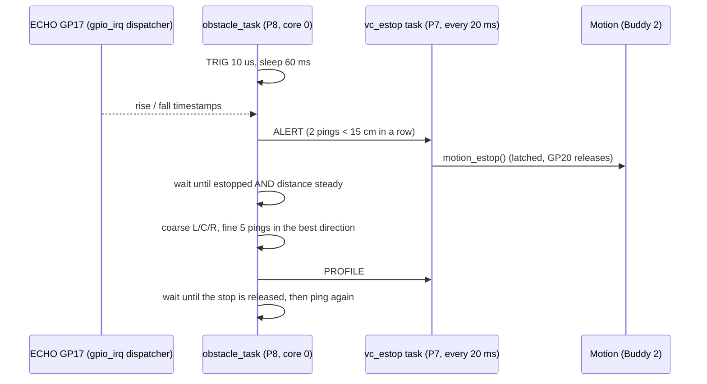

# Subsystem 5 rework: what changed and why (for Buddy 5)

From: Buddy 4 (integration branch / Vehicle Controller). Date: 2026-11-03.
PR: **#9** `s5-rework-onto-integration` → `integrate/s4-onto-main`
(replaces #7 / #8 `ultra-implementation1`). **Nothing is merged yet: please
review #9 and change anything you disagree with. It is your subsystem.**

## TL;DR

- Your branch (all commits up to `27bddfc`) is merged as-is in `a7c2b38`,
  so your history and authorship are kept. My changes are one commit on
  top: `e07f370`.
- Why a rework was needed: **`main` does not build** (12 errors in
  `subsystem5/`), #8 conflicts with the integration branch in Buddy 2's
  `subsystem2.c/.h`, and a few parts went against Tribunal 1 decisions
  (details below).
- Same behaviour as your design: forward ping, stop when an obstacle is
  close, coarse scan at 15 / 110 / 178 deg, fine scan in the best
  direction, report. What changed is **how** it is wired and timed.
- Built clean (`make -j8`, `make TEST=1 -j8`, 0 errors, 0 warnings).
  **Not run on the car yet.**

## 1. Build errors on `main` (now fixed)

`main` after PR #5 fails with, among others:

```text
obstacle.c:   error: unknown type name 'UINT8'
servo.c:      fatal error: hardware/pwm.h: No such file or directory
ultrasonic.c: error: too few arguments to function 'gpio_set_pin'
ultrasonic.c: warning: implicit declaration of function 'gpio_set_dir'
```

#8 fixed these on `main`; #9 keeps those fixes and adds the rest below.

## 2. What was removed, and why

| In #8 | In #9 | Reason |
|---|---|---|
| `vehicle_controller_task()` + `SCAN_REQUEST` / `OBSTACLE_PROFILE` / `mbx_scan_req` / `mbx_obstacle_rpt` / `S2_PRI_VEHICLE 7` in **`subsystem2/subsystem2.c/.h`** | removed; `subsystem2/` is exactly the integration version | The VC already exists in `app_program/vehicle_controller.c` (one VC, no hardware). Only Buddy 2 edits `subsystem2/`. Priority 7 was already taken by `vc_estop`. That task also called `motion_set_duty(100, 100, 3000)` every 200 ms, which **fights the line follower** for the motors, and the call is rejected anyway (`MOTION_MAX_LEASE_MS` is 1000 → `E_PAR`) |
| `obstacle.c` calls `motion_stop()` | S5 never touches the motors | Tribunal 1 safety path: S5 **reports**, the VC decides and stops the car. Also, a `motion_stop()` is undone by S3's next line-drive command 10 ms later |
| `SCAN_REQUEST req` on the VC task's **stack**, sent with `tk_snd_mbx` | no scan-request object | A mailbox passes a pointer: the message must outlive the queue (fixed memory pool, CLAUDE.md §5). Re-sending the same stack struct after a timeout while it may still be queued corrupts the mailbox's linked list. S5 now decides by itself when to scan (§4) |
| `typedef unsigned char UINT8;` in shared **`app.h`** | removed; `uint8_t` / `uint32_t` used | `app.h` is a shared file; Barr-C: fixed-width C99 types |
| `build_make/tools/elf2uf2.exe` | not taken | Build binary; `build_make/` is template, not ours to change |

## 3. Bugs fixed

1. **Servo PWM divider in the wrong bits.** `out_w(PWM_CH6_BASE +
   PWM_CHx_DIV, 125U << 24)`: the RP2040 DIV register holds the integer
   part in **bits 11:4**, so `<< 24` writes reserved bits and the divider
   is not 125, i.e. the servo would not run at 50 Hz. Now `SYSCLK << 4`,
   the same as `subsystem2/motor.c`. (If your servo test passed, it was
   probably on the older SDK version of `servo.c`.)
2. **`%.1f` in `tm_printf`.** Our `lib/libtm/libtm_printf.c` has no `%f`
   (only `d i u x X o p s c`): those numbers printed as garbage. All S5
   maths is now integer (the RP2040 has no FPU: floats are slow software
   emulation).
3. **Busy-wait ECHO timing.** `ultrasonic_measure()` spun on `TIMERAWL`
   for up to ~35 ms (5 ms + 30 ms timeouts) at **P8**, which blocks the
   **P9 IMU task** (10 ms period) on the same core. See §4.
4. A dead sensor (`-1.0`) was treated as an obstacle, so a loose cable
   would stop the car every ping. Now it is a separate FAULT report and
   the car keeps going (§5).

## 4. New design, file by file



**`ultrasonic.c/.h`**
- ECHO GP17 is attached to the **shared GPIO dispatcher**
  (`gpio_irq_attach(17, GPIO_IRQ_EDGE_BOTH, ...)`, team decision Tribunal 1).
  The callback `ultrasonic_echo_isr()` only stores `TIMERAWL` at the rising
  and the falling edge.
- `ultrasonic_measure_cm()`: TRIG high 10 us (the only busy wait), then
  `tk_dly_tsk(60)`, which is also the datasheet's >= 60 ms cycle, then
  reads the edge pair. No CPU burnt while waiting.
- Returns a **9-bit code**: `0` = no echo (no rising edge, or ECHO stuck
  high = sensor fault), `1..400` cm (`us / 58`), `400` = nothing in range.
- Task and callback both on core 0, so `volatile` words are enough here.

**`obstacle.c/.h`** (state machine, `S5_STATE_*`)
1. `FORWARD`: one ping straight ahead per cycle. **2 pings < 15 cm in a
   row** (`S5_CONFIRM_PINGS`, debounce) → ALERT. **5 pings without echo**
   (`S5_NO_ECHO_PINGS`) → one FAULT, repeated only after a good reading.
2. `WAIT_STOP`: scan only once `motion_is_estopped()` **and** the IF-10
   wheel distance (`motion_get_distance_mm()`) is steady for 200 ms
   (Tribunal 1: scanning starts only when the car is stationary). If the
   VC does not stop the car within 1 s, back to `FORWARD`.
3. `SCAN`: your coarse scan (500 ms servo settle each), then **5 pings in
   the best direction**, averaged over the valid ones (your fine scan),
   re-centre, send PROFILE.
4. `WAIT_RELEASE`: poll every 100 ms until the stop is released.
- S5 only **reads** Motion's status (`motion_is_estopped`,
  `motion_get_distance_mm`); it never commands it.

**`servo.c/.h`**: your register version kept; divider fixed (§3.1); angle
is `uint32_t`, clamped to 180; comments say it depends on `motor_init()`
taking the PWM block out of reset first (`subsystem2_init` runs before
`subsystem5_init`).

**`subsystem5.c/.h`**: init = ultrasonic + servo; task `obstacle_task` at
**P8** (TEAM.md §4), **pinned to core 0** (`S5_PRC_MAIN = TP_PRC1`),
because the ECHO callback runs on core 0. `subsystem5.h` now holds every
tunable and the IF-09 word layout (below).

**`subsystem5_test.c`**: S5-U08 / S5-U09, IF-09 round trip and clamping
(CR1 needs a round-trip test for every packed form). Your standalone tests
in `testing/subsystem5/` (S5-U01..U07) are untouched.

## 5. IF-09: the report to the VC (one packed `uint32_t`)

Replaces `OBSTACLE_PROFILE {UINT8 best_angle; float max_dist}` (which also
broke CR1's minimum-bit rule). TEAM.md IF-09 row updated.

| Bits | Field | Values |
|---|---|---|
| 8:0 | left cm | 9 bits: 0 = no echo, 1..400, 400 = nothing in range |
| 17:9 | centre cm | same |
| 26:18 | right cm | same |
| 28:27 | kind | 0 ALERT (centre only), 1 PROFILE, 2 FAULT |
| 30:29 | best | 0 left, 1 centre, 2 right, 3 none |
| 31 | 0 | |

Pack with `s5_profile_pack()`, unpack with `S5_P_LEFT/CENTRE/RIGHT/KIND/BEST`.
Sent **by value** into the VC's message buffer `vc_mbf_profile` (the
receiver owns the object; depth 8; `TMO_POL` both sides, so S5 never
blocks; a full buffer drops one word and the next ping sends again).

What the VC does with it (my side, `vehicle_controller.c`):
- **ALERT** → `motion_estop()` (latched; press GP20 to release). This is
  the interim stop until `EVG_stop` exists. Prints
  `[VC] obstacle at N cm: STOP`.
- **PROFILE** → prints `[VC] obstacle profile L .. C .. R .. cm, best ..`.
  Nothing drives around the obstacle yet: the bypass and line recovery
  are the next design step (yours with the VC and Buddy 2).
- **FAULT** → prints a warning, **does not stop the car**.
- Worst-case alert-to-stop latency about 160 ms (derived: 2 pings of
  60-70 ms + one VC poll of 20-30 ms). At ~7 cm/s that is about 1 cm.

## 6. Please confirm (marked CONFIRM / TODO_TUNE in the code)

1. **Which servo end is left?** I assumed 178 deg = left, 15 deg = right
   (a larger angle turns the sensor counter-clockwise seen from above).
2. **110 deg = straight ahead** on your mount (your value).
3. **15 cm alert threshold**, 2-ping debounce, 5-ping fault, 5 fine samples.
4. Whether you still want a **scan request** from the VC (your reasons 1-4:
   time, turn, barcode, line lost). If so, it should be a message buffer
   (copied) owned by S5, not a mailbox with a stack message.

## 7. How to test on the car (normal image from #9)

1. Boot, car on the line, HC-SR04 fitted. With nothing in front: no
   `[VC] obstacle` lines. Unplug ECHO: one `ultrasonic: no echo` line,
   the car keeps following.
2. Hand at ~10 cm in front: `[VC] obstacle at N cm: STOP`, motors stop,
   then the servo sweeps left / centre / right, re-centres, and
   `[VC] obstacle profile L .. C .. R .. cm, best ..` appears. Check that
   "left" really is left (item 6.1).
3. Press GP20: the car resumes; the next close object stops it again.
4. `make TEST=1`: S5-U08 and S5-U09 PASS.

Record the runs in `testing/subsystem5/TEST_LOG.md`.
